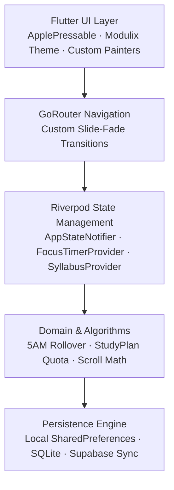

<div align="center">

# 🩺 Modulix
### Clinical-Grade MBBS & NEET-PG Medical Education Companion

[](https://github.com/RxREAPER/Modulix/actions/workflows/ci.yml)
[](https://flutter.dev)
[](https://dart.dev)
[](LICENSE)
[](https://flutter.dev)
[](https://dart.dev/guides/language/effective-dart)

<p align="center">
  A high-performance, clinical-grade medical syllabus tracker, habit anchor, and cognitive focus companion engineered for medical doctors and students preparing for <b>NEET-PG</b>, <b>INI-CET</b>, and <b>USMLE</b>.
</p>

</div>

---

## 🌟 Key Features

### 📚 1. Comprehensive 19 MBBS Subjects Curriculum
- Complete syllabus mapping across **Editions 6.5 & 8** (Anatomy, Physiology, Surgery, Medicine, etc.).
- Multi-modal tracking across **Videos**, **Q-Banks (MCQs)**, and **High-Yield Clinical Notes**.
- Instant search across all modules, unit numbers, titles, and clinical topics.
- Virtualized 120 FPS timeline with single-tap completion, elastic swipe-to-complete, and bulk unit marking.

### ⏱️ 2. Deep Focus Timer & Ambient Studio
- Built-in Pomodoro, Count-Up stopwatch, and Module-Linked study modes.
- Synthesized ambient sounds (forest rain, brown noise, crackling fireplace, deep stream).
- Persistent mini-timer overlay allowing seamless multi-tasking across curriculum pages.
- Immutable `TimeLog` recording for tamper-proof study analytics.

### 📝 3. Daily Desk & Intelligent Rollover
- Smart daily task scheduling adhering to the **5:00 AM clinical rollover algorithm**.
- Automated study plan quota engine: **"2 Stale + 2 Fresh = 4"** to prevent cognitive overload.
- Task status indicators (`[VID]`, `[MCQ]`, `[REV]`) with instant completion toggling.

### 📊 4. Analytics & Mastery Velocity
- True active study streaks and calendar distribution heatmaps.
- Subject-by-subject completion percentages and syllabus velocity calculations.
- Clean graphical metrics powered by lightweight vector rendering.

### 🐙 5. Nori: Organic Interactive Companion
- Interactive procedural blob companion rendered via custom math-driven fluid physics engine (`NoriBlobPainter`).
- State machine responding to study milestones, focus sessions, and streak achievements.
- Non-intrusive, zero-distraction clinical motivation.

### ⚡ 6. Silky Smooth 120 FPS & Apple-Grade Haptics
- Every interactive element features `ApplePressable` physical scale compression and subtle opacity response.
- GPU raster isolation via `RepaintBoundary` on list items.
- Non-blocking layout transitions and zero-stutter unit navigation.

---

## 🏛 System Architecture



---

## 🚀 Getting Started

### Prerequisites
- [Flutter SDK](https://docs.flutter.dev/get-started/install) (v3.24.0 or newer)
- [Dart SDK](https://dart.dev/get-dart) (v3.5.0 or newer)
- Android Studio with Android SDK API 34+ (for Android builds)
- Xcode 15+ (for iOS macOS builds)

### Installation & Run

1. **Clone the repository:**
   ```bash
   git clone https://github.com/RxREAPER/Modulix.git
   cd Modulix
   ```

2. **Install project dependencies:**
   ```bash
   flutter pub get
   ```

3. **Verify static analysis:**
   ```bash
   flutter analyze
   ```

4. **Run the automated test suite:**
   ```bash
   flutter test
   ```

5. **Launch on connected device or emulator:**
   ```bash
   flutter run
   ```

---

## 🧪 Testing & Quality Assurance

Modulix enforces strict static analysis and regression testing before any release:

```bash
# Run unit and widget test suites
flutter test

# Run coverage report
flutter test --coverage

# Run strict linter checks
flutter analyze
```

---

## 📂 Project Directory Structure

```
Modulix/
├── .github/                 # CI/CD Workflows, PR & Issue Templates
│   ├── workflows/           # GitHub Actions (CI & APK build)
│   └── ISSUE_TEMPLATE/      # Bug Report & Feature Request templates
├── android/                 # Android native configuration & Kotlin MainActivity
├── assets/                  # High-resolution audio, icons, illustrations, rive assets
├── curriculum_data/         # NEET-PG / MBBS comprehensive syllabus datasets
├── docs/                    # Deep technical architecture & feature specifications
│   ├── ARCHITECTURE.md      # State management, routing, and storage architecture
│   ├── BUILD_CHECKPOINTS.md # Incremental build and verification checkpoints
│   └── features/            # Feature design specs (timer, desk, streaks, etc.)
├── lib/
│   ├── config/              # App configuration & constants
│   ├── data/                # Syllabus metadata & questions
│   ├── models/              # Clinical syllabus, task, and timer domain models
│   ├── providers/           # Riverpod state notifiers and providers
│   ├── screens/             # UI Screens (Curriculum, Desk, Analytics, Timer, Settings)
│   ├── services/            # Storage, database, audio, tour, and sync services
│   ├── theme/               # Clinical parchment & dark theme definitions
│   └── widgets/             # Reusable widgets (ApplePressable, timeline, Nori)
├── test/                    # Unit, stress, and widget regression test suites
├── CHANGELOG.md             # Release history and milestone documentation
├── CONTRIBUTING.md          # Guidelines for contributing to Modulix
├── LICENSE                  # MIT License
└── pubspec.yaml             # Dependencies and Flutter project configuration
```

---

## 📖 In-Depth Documentation

For detailed architectural rationale, design decisions, and math algorithms, explore the [`docs/`](docs/) directory:

- 🏗️ **[System Architecture](docs/ARCHITECTURE.md)**: Riverpod patterns, partition models, and routing rules.
- ⏱️ **[Focus Timer Specification](docs/features/focus-timer.md)**: Timer modes, tick engine, and `TimeLog` format.
- 📝 **[Daily Desk & Rollover](docs/features/daily-desk-tasks.md)**: 5:00 AM rollover mathematics and task mutators.
- 📚 **[Curriculum & Virtualization](docs/features/curriculum-and-bulk-mark.md)**: Multi-modal syllabus and analytics-safe bulk marking.
- 📊 **[Analytics & Streaks](docs/features/analytics-and-streaks.md)**: Streak algorithms and distribution calculations.
- 🏷️ **[Build Checkpoint Manifest](docs/BUILD_CHECKPOINTS.md)**: Incremental checkpoint log and verification status.

---

## 📄 License

This project is licensed under the MIT License — see the [LICENSE](LICENSE) file for details.

---

<div align="center">
  <b>Crafted with clinical precision for medical doctors.</b>
</div>
