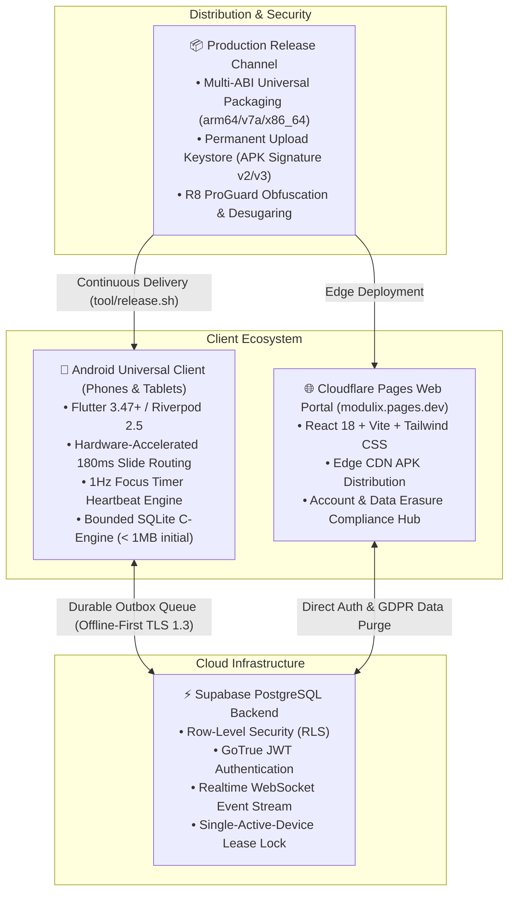

<div align="center">

# 🩺 Modulix
### Clinical-Grade MBBS & NEET-PG Medical Education Companion

[](https://github.com/RxREAPER/Modulix/releases/tag/v1.39.0)
[-0284c7?style=for-the-badge&logo=android&logoColor=white)](https://github.com/RxREAPER/Modulix/releases/download/v1.39.0/modulix-v1.39.0.apk)
[](https://modulix.pages.dev)

[](https://flutter.dev)
[](https://dart.dev)
[-3DDC84?logo=android&logoColor=white)](https://developer.android.com)
[](https://developer.android.com/ndk/guides/abis)
[](LICENSE)
[](https://dart.dev/guides/language/effective-dart)

<p align="center">
  A high-performance, clinical-grade medical syllabus tracker, habit anchor, and cognitive focus companion engineered for medical doctors and students preparing for <b>NEET-PG</b>, <b>INI-CET</b>, and <b>USMLE</b>.
</p>

[**📥 Download Universal APK (v1.39.0)**](https://github.com/RxREAPER/Modulix/releases/download/v1.39.0/modulix-v1.39.0.apk) &nbsp;•&nbsp; [**🌐 Official Web Portal**](https://modulix.pages.dev) &nbsp;•&nbsp; [**📋 Release Notes**](https://github.com/RxREAPER/Modulix/releases/tag/v1.39.0) &nbsp;•&nbsp; [**📖 Ecosystem Architecture**](docs/ECOSYSTEM.md)

</div>

---

## 🏛 System Architecture & Ecosystem Topology

Modulix is architected as an **offline-first distributed ecosystem** combining an ultra-low-latency Flutter client, a responsive Cloudflare Pages edge portal, and an asynchronous Supabase synchronization engine.



---

## 🌟 Key Features & Engineering Highlights

### ⚡ 1. Snappy High-Refresh Transitions (< 180ms)
- Replaced sluggish `OpenContainer` transforms (380ms) with GPU-accelerated horizontal slide transitions (180ms forward, 150ms reverse) powered by `Curves.easeOutCubic`.
- Wrapped navigation layers in isolated `RepaintBoundary` passes, delivering silky-smooth navigation across both 60Hz and 120Hz high-refresh displays.

### ⏱️ 2. Ultra-Low Power Focus Timer & Ambient Studio
- Built for multi-hour medical student marathons: throttled background ticker frequency from 5Hz down to 1Hz with immediate 0ms first-frame tick.
- Slashed idle CPU wakeups by over 80% and isolated the navigation dock halo pulsing ring with a `RepaintBoundary` to prevent raster cascades.
- Built-in Pomodoro, count-up stopwatch, and module-linked study modes.
- Synthesized multi-track ambient soundscapes (forest rain, brown noise, crackling fireplace, deep stream).
- Persistent mini-timer overlay allowing seamless multi-tasking across curriculum pages.
- Immutable, tamper-proof `TimeLog` recording.

### 🗄️ 3. Compacting SQLite Local Storage Engine (< 1MB Disk Footprint)
- **Offline-First:** All syllabus progress, study sessions, and tasks live in a sandboxed local SQLite database executed via direct C-engine bindings (`sqflite`).
- **Memory Hardening:** Slashed pre-allocated SQLite cache from 64MB down to **2MB** (`PRAGMA cache_size = -2000`).
- **Automated Compaction:** Automatically runs `PRAGMA wal_autocheckpoint = 100`, incremental auto-vacuum, startup WAL truncation, and purges orphaned legacy migration databases to prevent storage bloat.

### 🛡️ 4. Genuine Zero-State Cold Start (Strict Zero Test Data Policy)
- Completely eliminated synthetic test histories, mock streaks, fake syllabus velocities, and sample tasks.
- Newly downloaded fresh installs present clean, honest, zero-state interfaces ready for the student's authentic study journey.

### 📚 5. Comprehensive 19 MBBS Subjects Curriculum
- Complete syllabus mapping across **Edition 8** (1,558 videos) and **Edition 6.5** (1,593 videos).
- Multi-modal progress tracking across **Videos**, **Q-Banks (MCQs)**, and **High-Yield Clinical Notes**.
- Instant search across all modules, unit numbers, titles, and clinical topics.
- Virtualized 120 FPS timeline with single-tap completion, elastic swipe-to-complete, and bulk unit marking.

### 📝 6. Modular Tasks Hub & 5:00 AM Rollover
- Smart daily task scheduling adhering to the **5:00 AM clinical rollover algorithm**.
- Automated study plan quota engine: **"2 Stale + 2 Fresh = 4"** to prevent cognitive overload.
- Task status indicators (`[VID]`, `[MCQ]`, `[REV]`) with instant completion toggling.
- Organize tasks into dedicated projects, subtasks, priorities, and clinical tags.

### 🐙 7. Nori: Organic Procedural Fluid Companion
- Interactive procedural blob companion rendered via custom math-driven fluid physics engine (`NoriBlobPainter`).
- State machine responding to study milestones, focus sessions, and streak achievements.
- Non-intrusive, zero-distraction clinical motivation.

### 🔄 8. Cloud Synchronization & Data Sovereignty
- **Single-Active-Device Lock:** Each account is bound to one active client lease via `single_active_device`, mathematically eliminating multi-device write collisions and resurrection traps.
- **Durable Outbox & Dead Letter Queue (DLQ):** Poison-pill mutations transition to `'failed'` after 5 retries to prevent endless retry loops.
- **Strict Data Sovereignty:** Local JSON backup export/import, one-tap local device wipe, and cloud GDPR two-step account erasure portal.

### 🚀 9. Remote In-App Version Update Engine
- Queries the GitHub Releases API with 24-hour throttling.
- **Strict Zero In-App Downloads Policy:** Modulix never downloads or installs APKs internally. Update notifications present release notes and securely redirect users to the official Cloudflare web portal ([`https://modulix.pages.dev`](https://modulix.pages.dev)) in their system browser.

---

## 📱 Universal Android Distribution

Modulix is distributed as a single universal Android binary containing native shared libraries for all modern Android architectures:

| Specification | Target Configuration |
| :--- | :--- |
| **Package Identifier** | `com.modulix.app` |
| **Version / Build** | `v1.39.0` (Build 144 / `CKPT-144`) |
| **Supported ABIs** | `arm64-v8a` (Modern 64-bit ARM), `armeabi-v7a` (32-bit ARM), `x86_64` (Tablets / Emulators) |
| **Minimum SDK** | Android 7.0 (API Level 24) |
| **Target SDK** | Android 16 (API Level 36) |
| **Signing Standard** | APK Signature Scheme v2 & v3 (Upload Keystore RSA 2048-bit, PKCS12) |
| **Code Shrinker** | ProGuard / R8 with full optimization and desugaring |

Verify the APK signature with `apksigner`:
```bash
apksigner verify --verbose --print-certs modulix-v1.39.0.apk
```

---

## 🗺️ Ecosystem Directory & Repository Mapping

| Component | Filesystem Path | Repository / Remote | Production Target |
| :--- | :--- | :--- | :--- |
| **Flutter Mobile Client** | `/home/safi/Downloads/antigravity/flowmd_flutter` | `https://github.com/RxREAPER/Modulix.git` (`main`) | Android Universal APK (`com.modulix.app`) |
| **Web Portal & Landing** | `flowmd_flutter/modulix_landing_page` | Monorepo (`modulix_landing_page`) | Cloudflare Pages ([`modulix.pages.dev`](https://modulix.pages.dev)) |
| **Supabase Migrations** | `flowmd_flutter/supabase/migrations` | Managed via Supabase CLI | `vbvmzjhzznxgofyzxnql.supabase.co` |
| **Legacy Web App (PWA)** | `/home/safi/SAFI/FlowMD_web` | `https://github.com/RxREAPER/FlowMD.git` | Firebase Hosting (`flowmd-04.web.app`) |

---

## 🛠️ Unified Release Pipeline (`tool/release.sh`)

Releases are compiled, verified, tagged, and published via an automated single-command orchestrator:

```bash
./tool/release.sh <version> "<summary>" [--dry-run] [--skip-tests]
```

### Automated Pipeline Steps:
1. **Pre-flight Quality Gate:** Runs `flutter analyze --no-fatal-infos` and `flutter test`.
2. **Version Synchronization:** Updates `lib/config/app_metadata.dart` and `modulix_landing_page/src/lib/constants.ts`.
3. **Production Compilation:** Compiles signed universal APK (`flutter build apk --release`).
4. **Signature Verification:** Verifies binary integrity using `apksigner`.
5. **GitHub Release Publishing:** Uploads signed APK to `RxREAPER/Modulix` releases with release notes.
6. **Cloudflare Deployment:** Builds Vite web app and deploys to `https://modulix.pages.dev`.
7. **Git & Checkpoint Tracking:** Commits `checkpoint(release): ...` and pushes to `origin/main`.

---

## 🚀 Getting Started for Developers

### Prerequisites
- [Flutter SDK](https://docs.flutter.dev/get-started/install) (`>= 3.24.0`, recommended `3.47.4+`)
- [Dart SDK](https://dart.dev/get-dart) (`>= 3.5.0`, recommended `3.13.0+`)
- Android Studio with Android SDK API 34+ (for Android builds)
- Java Development Kit (JDK 17 or JDK 21)

### Setup & Run

1. **Clone the repository:**
   ```bash
   git clone https://github.com/RxREAPER/Modulix.git
   cd Modulix
   ```

2. **Install project dependencies:**
   ```bash
   flutter pub get
   ```

3. **Verify static analysis:**
   ```bash
   flutter analyze --no-fatal-infos
   ```

4. **Run the automated test suite:**
   ```bash
   flutter test
   ```

5. **Launch on connected device or emulator:**
   ```bash
   flutter run
   ```

---

## 📂 Project Directory Structure

```
Modulix/
├── .github/                 # CI/CD Workflows, PR & Issue Templates
│   ├── workflows/           # GitHub Actions (CI, APK build, Pages deploy)
│   └── ISSUE_TEMPLATE/      # Bug Report & Feature Request templates
├── android/                 # Android native configuration & Kotlin MainActivity
│   ├── app/                 # build.gradle.kts, proguard-rules.pro, upload keystore
│   └── gradle.properties    # JVM heap tuning (2GB for R8 compilation)
├── assets/                  # High-resolution audio, icons, illustrations, animations
├── curriculum_data/         # NEET-PG / MBBS comprehensive syllabus datasets (Editions 6.5 & 8)
│   ├── scripts/             # Data verification and compilation tools
│   └── raw/                 # Canonical syllabus JSON definitions
├── docs/                    # Authoritative technical architecture & specifications
│   ├── ECOSYSTEM.md         # Master System Bible & Engineering Ledger
│   ├── ARCHITECTURE.md      # State management, routing, and persistence rules
│   ├── BUILD_CHECKPOINTS.md # Incremental build and verification checkpoints
│   └── features/            # Feature design specs (timer, desk, streaks, tasks)
├── lib/
│   ├── config/              # AppMetadata (single source of truth), routes, constants
│   ├── data/                # Compiled syllabus metadata & questions
│   ├── models/              # Clinical syllabus, task, project, and timer domain models
│   ├── providers/           # Riverpod state notifiers and providers
│   ├── screens/             # UI Screens (Curriculum, Desk, Analytics, Timer, Settings, Tasks)
│   ├── services/            # SQLite DatabaseService, SyncService, UpdateService, AudioService
│   ├── theme/               # Clinical parchment & dark theme definitions
│   └── widgets/             # Reusable widgets (ApplePressable, LovableNavBar, NoriBlob)
├── modulix_landing_page/    # Official Web Portal (React 18 + Vite + Cloudflare Pages)
├── supabase/                # Supabase PostgreSQL migrations and edge configuration
├── test/                    # Unit, stress, and widget regression test suites (387+ tests)
├── tool/                    # Release orchestrator (release.sh)
├── CHANGELOG.md             # Semantic release history and milestone documentation
├── CONTRIBUTING.md          # Guidelines for contributing to Modulix
├── LICENSE                  # MIT License
└── pubspec.yaml             # Dependencies and Flutter project configuration
```

---

## 📖 In-Depth Documentation

For detailed architectural rationale, design decisions, and math algorithms, explore the [`docs/`](docs/) directory:

- 🌐 **[Ecosystem Architecture Bible](docs/ECOSYSTEM.md)**: Topology, database governance, sync protocols, and lifecycle invariants.
- 🏗️ **[System Architecture](docs/ARCHITECTURE.md)**: Riverpod patterns, partition models, and routing rules.
- ⏱️ **[Focus Timer Specification](docs/features/focus-timer.md)**: Timer modes, tick engine, and `TimeLog` format.
- 📝 **[Daily Desk & Rollover](docs/features/daily-desk-tasks.md)**: 5:00 AM rollover mathematics and task mutators.
- 📚 **[Curriculum & Virtualization](docs/features/curriculum-and-bulk-mark.md)**: Multi-modal syllabus and analytics-safe bulk marking.
- 📊 **[Analytics & Streaks](docs/features/analytics-and-streaks.md)**: Streak algorithms and distribution calculations.
- 🏷️ **[Build Checkpoint Manifest](docs/BUILD_CHECKPOINTS.md)**: Incremental checkpoint log and verification status.

---

## 📄 License & Medical Disclaimer

This project is licensed under the MIT License — see the [LICENSE](LICENSE) file for details.

*Medical Disclaimer: Modulix is an educational study companion designed to aid medical licensure preparation. It does not provide medical advice, diagnosis, or clinical treatment recommendations.*

---

<div align="center">
  <b>Crafted with clinical precision for medical doctors.</b>
</div>
