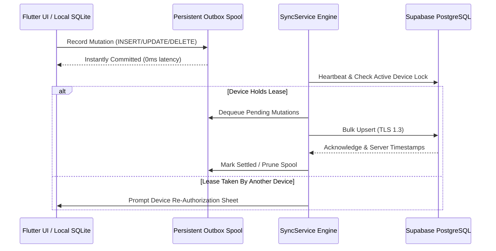

# Modulix — System Architecture & Ecosystem Manual
> **Authoritative System Bible & Engineering Ledger**  
> *Target Audience: Lead Engineers, System Architects, DevOps, and Autonomous AI Pair-Programmers.*

---

## 1. Executive Summary & Topology

**Modulix** is an offline-first, clinical-grade medical syllabus tracker, habit anchor, and cognitive focus companion engineered for medical doctors and students preparing for high-stakes licensure exams (NEET-PG, INI-CET, USMLE).

### High-Level Topology:

```
┌────────────────────────────────────────────────────────────────────────┐
│                        MODULIX CLIENT ECOSYSTEM                        │
├──────────────────────────────────┬─────────────────────────────────────┤
│  Flutter Mobile Client (Android) │   Web Portal & Marketing Landing    │
│  - Offline-first SQLite C-engine │   - React 18 + Vite + Tailwind CSS  │
│  - Riverpod 2.5 State Graph      │   - Cloudflare Pages Edge Network   │
│  - GoRouter Declarative Nav      │   - Supabase Account Deletion Auth  │
│  - In-App Remote Update Engine   │   - Direct APK Distribution Hub     │
└─────────────────┬────────────────┴──────────────────┬──────────────────┘
                  │                                   │
                  ▼                                   ▼
┌──────────────────────────────────┐ ┌───────────────────────────────────┐
│     SUPABASE CLOUD BACKEND       │ │       DISTRIBUTION INFRA          │
├──────────────────────────────────┤ ├───────────────────────────────────┤
│  PostgreSQL with Row-Level Sec.  │ │  GitHub Releases (v1.38.0+)       │
│  GoTrue JWT Authentication       │ │  Direct Web (.apk at Pages.dev)   │
│  Realtime CDC Presence Broadcast │ │  Signed via Production Keystore   │
│  Single-Active-Device Sync Lock  │ │  Amazon Appstore / F-Droid Ready  │
└──────────────────────────────────┘ └───────────────────────────────────┘
```

---

## 2. Directory Layout & Repository Mapping

| Component | Filesystem Path | Git Remote | Deployment Target |
| :--- | :--- | :--- | :--- |
| **Flutter Mobile App** | `/home/safi/Downloads/antigravity/flowmd_flutter` | `https://github.com/RxREAPER/Modulix.git` (branch `main`) | Android APK / AAB |
| **Web Portal & Landing** | `flowmd_flutter/modulix_landing_page` | Inside `flowmd_flutter` workspace | Cloudflare Pages (`modulix.pages.dev`) |
| **Supabase Migrations** | `flowmd_flutter/supabase/migrations` | Managed via Supabase CLI | `vbvmzjhzznxgofyzxnql.supabase.co` |
| **Legacy Web App (PWA)** | `/home/safi/SAFI/FlowMD_web` | `https://github.com/RxREAPER/FlowMD.git` | Firebase Hosting (`flowmd-04.web.app`) |

---

## 3. Data Architecture & Database Governance

Modulix is strictly **offline-first**. Network failure, airplane mode, or rural hospital rotas must never block user progress tracking or subject study.

### A. Local SQLite Engine (`DatabaseService`)
- **Engine:** Direct `sqflite` with native C-engine execution.
- **Location:** Local sandboxed database (`modulix.db`).
- **Core Tables:**
  1. `study_time_logs`: High-frequency subject timer logs with start/end timestamps and duration.
  2. `daily_desk_tasks`: Daily clinical quest tasks, 5:00 AM rollover quotas, and completions.
  3. `syllabus_completions`: Unit and topic checkmarks mapped across Marrow Editions 8 and 6.5.
  4. `task_projects` & `task_items`: Modular Tasks Hub boards and checklist items.
  5. `user_profile`: Active curriculum edition, minutes-per-day study targets, theme preferences.

#### Schema Invariants & Migration Rules:
1. **Never drop or rename existing production columns.** Always append new nullable or defaulted columns in incremental `onUpgrade` blocks.
2. **Keep indexes clean:** Index `subject_id`, `completed_at`, `edition`, and `device_id` to guarantee sub-millisecond aggregations.
3. **C-Engine Aggregations:** Run analytics sums and counts directly in SQL queries (`SELECT SUM(duration_minutes) ...`) rather than loading raw row lists into Dart memory.

---

### B. Cloud Synchronization Protocol (`SyncService`)

Cloud synchronization is optional, backgrounded, and fully decoupled from local UI rendering.



#### Synchronization Rules:
1. **Single-Active-Device Lock:** Each user account is strictly bound to one active client lease via `single_active_device` table. Prevents concurrent multi-device race conditions and data corruption.
2. **Dead Letter Queue (DLQ):** Poison-pill mutations transition to `'failed'` after 5 retries to prevent network retry loops.
3. **Resurrection Trap Elimination:** Deleted items durably persist tombstone records and dirty edition markers in `SharedPreferences` across application reboots.

---

## 4. In-App Versioning & Update Engine

Modulix features an automated remote version discovery engine with **zero in-app APK downloads** to preserve user security and comply with app store policies.

### A. Single Source of Truth (`lib/config/app_metadata.dart`)
- Defines `currentVersion` (`1.38.0`), `buildNumber` (`140`), `checkpoint` (`CKPT-140`), and official endpoints.
- All in-app screens (e.g. `AboutScreen`) consume this class dynamically.

### B. Remote Version Discovery (`UpdateService`)
- Queries GitHub Releases API: `https://api.github.com/repos/RxREAPER/Modulix/releases/latest`.
- **Throttling:** Checks automatically on launch at most once every 24 hours via `SharedPreferences`.
- **Manual Trigger:** User can tap *"Check for Updates"* in Settings -> About Screen.
- **Redirection Policy:** If an update is detected, the app presents a clean sheet with release notes and a **"Visit Website to Update"** button that redirects the user to `https://modulix.pages.dev` in their system browser. **The app never downloads or installs APKs internally.**

---

## 5. Security, Keystores & Production Hardening

### A. Production Upload Keystore
- **Location:** `android/app/upload-keystore.jks` (Protected & Gitignored).
- **Credentials:** `android/key.properties` (Protected & Gitignored).
- **Key Specs:** RSA 2048-bit, Alias `upload`, PKCS12 compliant.
- **Signature Schemes:** APK Signature Scheme v2 & v3 enabled.
- **Permanent Continuity:** All future updates must be signed with this exact keystore to guarantee user SQLite databases and streaks are never wiped during app updates.

### B. Permission Minimization & Policy Compliance
- High-risk permissions (`REQUEST_IGNORE_BATTERY_OPTIMIZATIONS`, `FOREGROUND_SERVICE`, `FOREGROUND_SERVICE_MEDIA_PLAYBACK`) are stripped from `AndroidManifest.xml`.
- Battery management uses standard Android Settings intents (`ACTION_IGNORE_BATTERY_OPTIMIZATION_SETTINGS`).
- Earbud disconnect detection uses dynamic `ACTION_AUDIO_BECOMING_NOISY` broadcast receiver.

### C. ProGuard / R8 Shrinking
- Code shrinking and optimization rules live in `android/app/proguard-rules.pro`.
- Preserves native Flutter bindings, SQLite wrappers, and desugared `java.time.**` APIs.

---

## 6. Unified Release Pipeline (`tool/release.sh`)

Releases are executed through a single command orchestrator:

```bash
./tool/release.sh <version> "<summary>" [--dry-run] [--skip-tests]
```

### What `tool/release.sh` executes automatically:
1. **Pre-flight Quality Gate:** Runs `flutter analyze --no-fatal-infos` and `flutter test`.
2. **Version Synchronization:** Updates `lib/config/app_metadata.dart` and `modulix_landing_page/src/lib/constants.ts`.
3. **Production Compilation:** Compiles signed ARM64 APK (`flutter build apk --release`).
4. **Signature Verification:** Verifies binary using `apksigner`.
5. **GitHub Release Publishing:** Uploads signed APK to `RxREAPER/Modulix` releases with release notes.
6. **Cloudflare Deployment:** Builds Vite web app and deploys to `https://modulix.pages.dev`.
7. **Git & Checkpoint Tracking:** Commits `checkpoint(release): ...` and pushes to `origin/main`.

---

## 7. Operational Rules for AI Co-pilots & Developers

When working on Modulix in any AI session:

1. **Verify Context First:** Always review `docs/ECOSYSTEM.md` and `docs/BUILD_CHECKPOINTS.md` before initiating changes.
2. **Scope-Based Testing:**
   - Small tweaks (text, spacing, colors): Run `flutter analyze` only.
   - Big changes (new screens, models, database updates): Run full test suite and verify build.
3. **Checkpoint Ledger Enforcement:** Every non-trivial change must register an entry in `docs/BUILD_CHECKPOINTS.md` with a matching git commit (`checkpoint(<category>): <summary>`).
4. **Credential Protection:** Never track or unignore keystores, `.env` files, or `key.properties`.
5. **No Emojis / Luxury Aesthetic:** Keep user-facing strings concise, clean, and free of emoji clutter.
